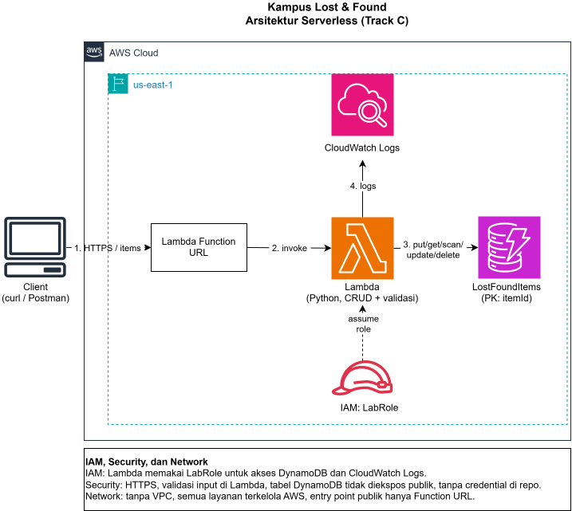

# Lost & Found Kampus

Aplikasi serverless di AWS untuk melaporkan dan mencari barang hilang atau ditemukan di lingkungan kampus.

- **Mata kuliah:** Cloud Computing (AWS), Individual Project
- **Nama / NIM:** Muhammad Izzuddin Prakoso / 24/537712/TK/59618
- **Track:** C, Serverless (Lambda Function URL + Lambda + DynamoDB)

## 1. Latar Belakang & Use Case
Barang yang hilang di kampus sering tidak kembali karena tidak ada tempat terpusat untuk melapor.
Aplikasi ini menyediakan REST API sederhana agar mahasiswa bisa melaporkan barang hilang,
melaporkan barang yang ditemukan, dan menandai barang yang sudah diklaim.

## 2. Arsitektur



Alur request:
Client -> Lambda Function URL -> Lambda (LabRole) -> DynamoDB -> response JSON

| Komponen | Fungsi |
|---|---|
| Lambda Function URL | Pintu masuk HTTPS publik untuk Lambda (routing dilakukan di `handler.py`) |
| AWS Lambda (Python 3.x) | Logika CRUD dan validasi input |
| DynamoDB (`LostFoundItems`) | Penyimpanan data, on-demand |
| IAM (`LabRole`) | Execution role Lambda untuk akses DynamoDB |
| CloudWatch Logs | Log dan debugging |

## 3. Data Entity: `Item`

| Atribut | Tipe | Keterangan |
|---|---|---|
| `itemId` | String (PK) | UUID |
| `title` | String | Nama barang |
| `description` | String | Ciri-ciri barang |
| `type` | String | `lost` atau `found` |
| `location` | String | Lokasi hilang / ditemukan |
| `contact` | String | Kontak pelapor |
| `status` | String | `open` atau `claimed` |
| `createdAt` | String | Timestamp ISO 8601 |

## 4. API Endpoints

| Method | Path | Deskripsi |
|---|---|---|
| POST | `/items` | Buat laporan baru |
| GET | `/items` | Daftar semua barang (opsional `?status=open`) |
| GET | `/items/{id}` | Detail satu barang |
| PUT | `/items/{id}` | Update data / ubah status |
| DELETE | `/items/{id}` | Hapus laporan |

Contoh request:

```bash
curl -X POST https://<function-url-id>.lambda-url.us-east-1.on.aws/items \
  -H "Content-Type: application/json" \
  -d '{"title":"Dompet hitam","type":"lost","location":"Gedung C","contact":"08xx"}'
```

## 5. Security & IAM
- Lambda memakai `LabRole` (Learner Lab tidak mengizinkan pembuatan role baru).
- Input divalidasi di Lambda sebelum ditulis ke DynamoDB.
- Tabel DynamoDB tidak diekspos langsung, akses hanya lewat Lambda dengan LabRole.
- Tidak ada credential di dalam repo.
- API Gateway tidak tersedia di Learner Lab (ditolak `apigateway:POST`), sehingga Lambda Function URL dipakai sebagai entry point.
- Function URL bersifat publik (`AuthType NONE`), sehingga validasi input di Lambda menjadi penjaga utama.

## 6. Struktur Repository

```
kampus-lostfound-aws/
  README.md
  .gitignore
  docs/
    architecture.svg
    architecture.drawio
    design-brief.md
  lambda/
    handler.py
  events/
  screenshots/
```

## 7. Deployment Plan

1. Buat tabel DynamoDB `LostFoundItems` (partition key `itemId` String, on-demand, region us-east-1).
2. Buat fungsi Lambda, upload `lambda/handler.py`, set execution role ke `LabRole`.
3. Aktifkan Function URL (`AuthType NONE`) pada fungsi Lambda, dan implementasikan routing sesuai tabel endpoint di `handler.py`.
4. Catat Function URL dari konfigurasi Lambda.
5. Uji dengan `curl` / Postman.

## 8. Bukti Setup AWS (Week 12)

Catatan: screenshot di repository ini disamarkan (ID akun AWS dan Function URL ditutup kotak hitam). Versi asli dikirim langsung ke dosen.

| Bukti | File |
|---|---|
| Tabel DynamoDB `LostFoundItems` berstatus Active (partition key `itemId`, on-demand) | `screenshots/dynamodb-table.png` |
| Fungsi Lambda `LostFoundHandler` dan Function URL | `screenshots/lambda-function-url.png` |
| Environment variable `TABLE_NAME` = `LostFoundItems` | `screenshots/lambda-env.png` |
| Execution role Lambda = `LabRole` | `screenshots/lambda-labrole.png` |
| Log group CloudWatch `/aws/lambda/LostFoundHandler` | `screenshots/cloudwatch-logs.png` |
| Uji koneksi end-to-end: `GET /health` mengembalikan `{"status":"ok","table":"LostFoundItems"}` | `screenshots/curl-health.png` |
| Log eksekusi Lambda (`START`, `END`, `REPORT`) lewat `aws logs tail` | `screenshots/logs-tail.png` |

Rantai yang terbukti: Client -> Lambda Function URL -> Lambda (LabRole) -> DynamoDB, plus CloudWatch Logs.

## 9. Progress

- [x] Pilih use case dan track
- [x] Design brief dan diagram
- [x] Tabel DynamoDB
- [x] Lambda handler dasar (`/health`)
- [x] Function URL aktif dan routing pertama (`GET /health`)
- [ ] CRUD lengkap (Week berikutnya)

## 10. Catatan & Keterbatasan
- Memakai AWS Learner Lab, sehingga resource mengikuti batas sesi lab.
- Region: us-east-1.
- Filter data (`?status=open`) dilakukan di Lambda setelah `Scan`, sehingga cocok untuk skala kecil.
