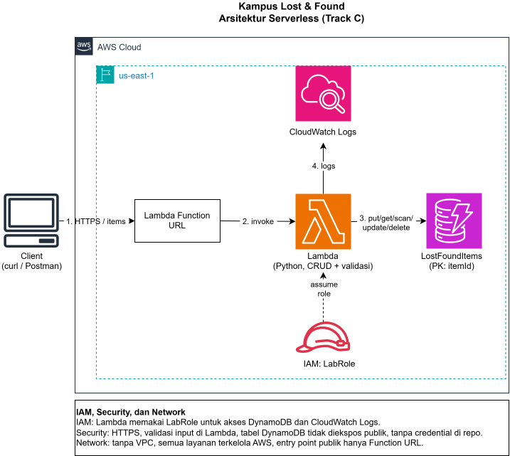

# Design Brief: Kampus Lost & Found (AWS Serverless)

**Nama / NIM:** Muhammad Izzuddin Prakoso / 24/537712/TK/59618
**Track:** C, Serverless (Lambda Function URL + Lambda + DynamoDB)

## 1. Use Case
Barang yang hilang di lingkungan kampus sering tidak kembali ke pemiliknya karena tidak ada
tempat terpusat untuk melapor atau mencari. Laporan biasanya tersebar di grup chat dan papan
pengumuman, sehingga sulit dicari dan cepat tenggelam.

Kampus Lost & Found menyediakan REST API sederhana agar mahasiswa dapat:
- melaporkan barang yang hilang,
- melaporkan barang yang ditemukan,
- mencari dan melihat daftar laporan,
- menandai barang sebagai sudah diklaim, atau menghapus laporan.

## 2. Arsitektur
Alur request:

Client (Postman/curl) -> Lambda Function URL -> Lambda -> DynamoDB -> response JSON

| Komponen | Peran |
|---|---|
| Lambda Function URL | Endpoint HTTPS publik yang langsung memanggil Lambda; routing `/items` dilakukan di kode Lambda |
| AWS Lambda (Python) | Menjalankan logika CRUD dan validasi input |
| DynamoDB `LostFoundItems` | Menyimpan data laporan (mode on-demand) |
| IAM `LabRole` | Execution role Lambda untuk membaca/menulis DynamoDB dan menulis log |
| CloudWatch Logs | Menyimpan log eksekusi Lambda untuk debugging |

Filter data dilakukan di Lambda setelah `Scan`, sehingga cocok untuk skala kecil (ratusan item).

Diagram sumber (dapat diedit di draw.io): `docs/architecture.drawio`.

## 3. Data Entity: `Item`

| Atribut | Tipe | Keterangan |
|---|---|---|
| `itemId` | String (partition key) | UUID, dibuat oleh Lambda |
| `title` | String | Nama barang |
| `description` | String | Ciri-ciri barang |
| `type` | String | `lost` atau `found` |
| `location` | String | Lokasi hilang / ditemukan |
| `contact` | String | Kontak pelapor |
| `status` | String | `open` atau `claimed` |
| `createdAt` | String | Timestamp ISO 8601 |

## 4. Endpoint CRUD

| Operasi | Method | Path | Deskripsi |
|---|---|---|---|
| Create | POST | `/items` | Buat laporan baru, status awal `open` |
| Read | GET | `/items` | Daftar semua barang, filter `?status=open\|claimed` dan `?type=lost\|found` |
| Read | GET | `/items/{id}` | Detail satu barang |
| Update | PUT | `/items/{id}` | Ubah data atau tandai `claimed` |
| Delete | DELETE | `/items/{id}` | Hapus laporan |

Format request/response menggunakan JSON. Kode status: 200 (OK), 201 (dibuat),
400 (input tidak valid), 404 (tidak ditemukan), 405 (method tidak diizinkan),
413 (body terlalu besar), 500 (error server). Endpoint tambahan `GET /health` menguji koneksi Lambda ke DynamoDB.

Aturan input: `title`, `type`, `location`, `contact` wajib saat membuat laporan; `type` hanya `lost` atau `found`;
`status` hanya `open` atau `claimed`; `PUT` bersifat partial update; `itemId`, `createdAt`, `updatedAt` diatur server.

**Status implementasi:** kelima operasi CRUD sudah berjalan di AWS dan lulus 22 pengecekan uji
end-to-end (`scripts/test_api.sh`, hasil di `docs/evidence-api-test.txt`).

## 5. IAM dan Security
- Lambda menggunakan **LabRole** sebagai execution role, karena Learner Lab tidak mengizinkan
  pembuatan role baru. Role ini memberi akses ke DynamoDB dan CloudWatch Logs.
- Akses DynamoDB hanya lewat Lambda, tabel tidak diekspos langsung ke publik.
- Input divalidasi di Lambda (field wajib, nilai `type` dan `status` hanya yang diizinkan).
- Tidak ada credential atau access key di repository; `.gitignore` memblokir file sensitif.
- Function URL diakses lewat HTTPS dan bersifat publik (`AuthType NONE`), sehingga validasi input di Lambda menjadi penjaga utama.
- API Gateway tidak digunakan karena ditolak di Learner Lab (`apigateway:POST`).

## 6. Rencana Deployment
1. Buat tabel DynamoDB `LostFoundItems` (partition key `itemId`, on-demand).
2. Buat fungsi Lambda dengan execution role LabRole, lalu upload `lambda/handler.py`.
3. Aktifkan Function URL (`AuthType NONE`) pada fungsi Lambda, dan implementasikan routing sesuai tabel endpoint di kode Lambda.
4. Catat Function URL dari konfigurasi Lambda.
5. Uji dengan curl/Postman dan simpan bukti di `screenshots/`.

Seluruh langkah dapat diulang dengan `bash scripts/deploy.sh` (idempoten), berguna karena resource lab dapat hilang saat sesi di-reset.